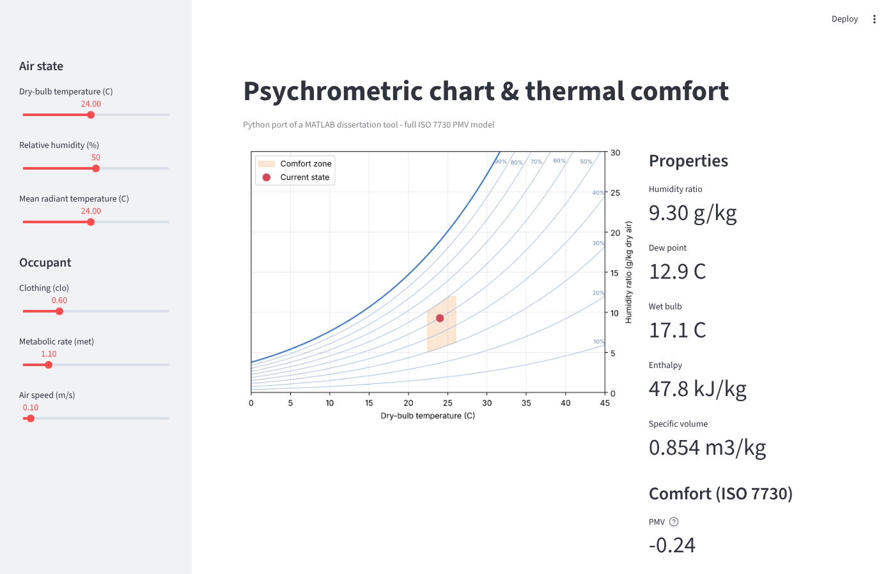
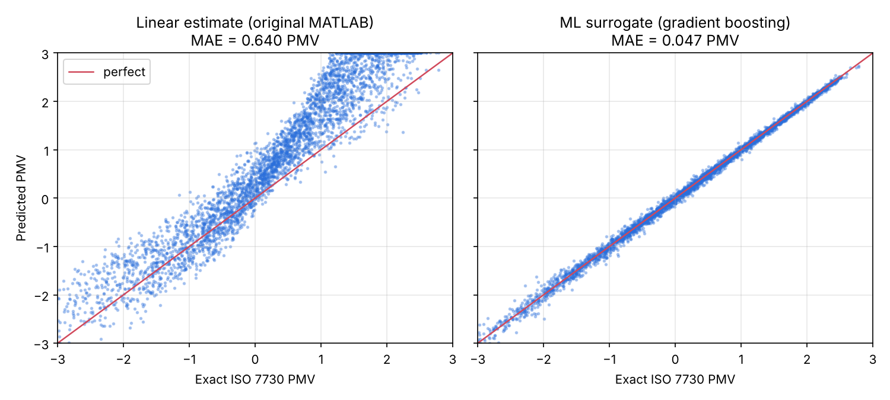

# Psychrometric Comfort Tool

**An interactive psychrometric chart and thermal-comfort analyser, built in MATLAB for my BEng dissertation (81%), then ported to Python and extended with machine learning.**



<!-- TODO: add a GIF of the MATLAB app here: docs/images/matlab_app.gif -->

## What it does

| | MATLAB app | Python package + web demo |
|---|:---:|:---:|
| Click anywhere on the chart to get every moist-air property | ✅ | ✅ (sliders) |
| Solve a state from any two properties (T, RH, W, wet bulb, dew point, enthalpy, volume) | ✅ | ✅ (T + RH / W / wet bulb) |
| HVAC process analysis between two points, apparatus dew point, SHR | ✅ | ADP ✅ |
| Sensible / latent heat-load calculator | ✅ | – |
| ASHRAE 55 comfort zone that moves with clothing, activity and air speed | ✅ | ✅ |
| Thermal comfort index | Linear PMV estimate | **Full ISO 7730 PMV / PPD** |
| Live readings from a BME280 sensor via Arduino | ✅ | – |
| SI and Imperial units | ✅ | SI |
| Machine-learning comfort models | – | ✅ |
| Automated tests against published reference data | ✅ | ✅ (CI on every push) |

## Machine learning

### Stage 1: check the ML pipeline against physics (runs out of the box)

Random indoor conditions (16–32 °C, 20–80 % RH, 0.3–1.5 clo, 0.9–2.0 met, 0.05–1 m/s) are labelled with the **exact ISO 7730 PMV**. A gradient-boosted model is trained on 16,000 of them and tested on 4,000 it hasn't seen. This also measured how far the original MATLAB app's linear PMV shortcut was from the full model:



| Method | MAE vs exact PMV (all conditions) | MAE (typical office conditions only) |
|---|---|---|
| Linear estimate (original MATLAB app) | 0.64 | 0.30 |
| ML model | **0.05** | **0.07** |

The ISO 7730 comfort band is only ±0.5 PMV wide, so the linear shortcut was too coarse for comfort decisions. That finding led to implementing the full model in this version.

### Stage 2: learn from real people (needs the free ASHRAE dataset)

PMV is known to mispredict how real occupants feel, especially in naturally ventilated buildings. `scripts/train_on_ashrae_db2.py` trains on the real thermal-sensation votes in the [ASHRAE Global Thermal Comfort Database II](https://doi.org/10.6078/D1F671) and compares the ML model against PMV on held-out data.

<!-- TODO: once run, add the stage-2 results table here -->

## Validation

| Check | Reference | Result |
|---|---|---|
| Saturation pressure, −10 to 40 °C | ASHRAE Handbook – Fundamentals, Ch. 1 Table 3 | within 0.1 % |
| 20 °C / 50 % RH state point (W, dew point, wet bulb, h, v) | CoolProp `HAPropsSI` | matches to ≤ 0.05 °C / 0.1 kJ/kg |
| PMV / PPD | ISO 7730 Table D.1 example, and the CBE `pythermalcomfort` library | matches to 0.01 PMV |

While writing the tests I found and fixed a bug in the live-sensor wet-bulb function. It used a dimensionally inconsistent formula that read about 3 °C low (10.5 °C instead of 13.7 °C at 20 °C / 50 % RH). A regression test now covers it.

## Repository layout

```
matlab/
  psychrometric_interactive.m   GUI and callbacks
  +psychro/                     pure psychrometric & comfort functions
  +bme280/                      BME280 sensor calibration / compensation
  tests/PsychroTest.m           matlab.unittest suite
python/
  psychro/properties.py         moist-air properties (SI)
  psychro/comfort.py            ISO 7730 PMV/PPD, comfort zone
  psychro/ml.py                 ML comfort models
  scripts/                      training scripts
  app.py                        Streamlit web demo
  tests/                        pytest suite
hardware/                       sensor wiring
```

## Run it

**MATLAB** (R2019b+). The Live Sensor tab needs the *MATLAB Support Package for Arduino Hardware*.

```matlab
cd matlab
psychrometric_interactive
results = runtests('tests');   % run the test suite
```

**Python** (3.10+)

```bash
cd python
pip install -r requirements.txt
pytest                                  # run tests
python scripts/train_surrogate.py       # ML stage 1
streamlit run app.py                    # web demo
```

## Methods

* Saturation pressure: Magnus/Buck-type correlation, over water and over ice.
* Wet bulb: ASHRAE Fundamentals (2017) Ch. 1 Eq. 33, solved by root-finding.
* Comfort zone: ASHRAE 55 graphic-method bands (0.5 clo: 23.0–26.5 °C, 1.0 clo: 20.0–24.0 °C) with met and air-speed adjustments.
* PMV / PPD: ISO 7730:2005 Annex D (Fanger heat-balance model).
* BME280: Bosch datasheet compensation formulas.

## About

Built by **Umair Ali Tariq**, BEng Mechanical Engineering (1st), University of Sussex.
Dissertation: *Developing MATLAB software for simulating thermal comfort.*

MIT licensed.
